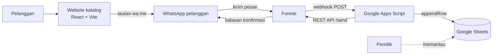

# WE'TU Kopi — Katalog & Pemesanan via WhatsApp Bot

Proyek Capstone Design (S1 Sistem Informasi, Universitas Telkom, 2026) untuk UMKM **Wetu Kopi**, usaha kopi pre-order yang melayani karyawan perkantoran Pertamina Hulu Rokan.

Sebelumnya informasi produk dan pesanan diurus manual lewat chat WhatsApp/Instagram pribadi pemilik. Proyek ini menggantinya dengan alur yang lebih terstruktur:

1. Pelanggan membuka **website katalog**, memilih menu, lalu mengisi keranjang dan data pengantaran.
2. Website menyusun **template pesan** dan membuka WhatsApp ke nomor bot Wetu Kopi.
3. Pesan diterima **Fonnte** (gateway WhatsApp) dan diteruskan lewat webhook ke **Google Apps Script**.
4. Apps Script mencatat pesanan ke **Google Sheets** dan membalas pelanggan dengan **konfirmasi otomatis**.
5. Pemilik memantau pesanan di Google Sheets, lalu memproses pembayaran dan pengantaran.



## Fitur

**Website (`src/App.tsx`)**
- Katalog 9 menu dengan filter kategori (Signature, Manual Brew, Non-Coffee, Pastry & Snack) dan pencarian
- Kustomisasi minuman (tingkat gula, es/panas)
- Keranjang: ubah jumlah, hapus item, subtotal otomatis, ongkir Rp5.000 dan gratis untuk minimal 3 item
- Form pemesan (nama, nomor WhatsApp, alamat, catatan) dengan validasi
- Penandaan lokasi di peta (Leaflet + OpenStreetMap): geser pin, lokasi GPS, pencarian alamat, tautan Google Maps otomatis
- Template pesan WhatsApp lengkap dengan ID pesanan `WT-xxxx`

**Bot & pencatatan (`google-apps-script.js`)**
- Webhook `doPost` untuk Fonnte; pesan selain pesanan diabaikan
- Ekstraksi nama, nomor, alamat, detail pesanan, total, catatan, dan ID pesanan dari isi pesan
- Pencatatan ke Google Sheets (7 kolom) dengan nomor WhatsApp disimpan sebagai teks
- Balasan konfirmasi otomatis via Fonnte API

## Struktur Repo

```
├── src/
│   ├── App.tsx            # Seluruh UI & logika pemesanan (katalog, keranjang, peta, template WA)
│   ├── main.tsx           # Entry point React
│   └── index.css          # Tailwind CSS v4 + style global
├── public/                # Logo & favicon (logo PNG disimpan via Git LFS)
├── google-apps-script.js  # Kode webhook untuk Google Apps Script (disalin manual ke editor Apps Script)
├── index.html
├── vite.config.ts         # Konfigurasi Vite (mengimpor .figma/make/site.json, jangan hapus folder .figma)
├── package.json / pnpm-lock.yaml
└── .mise.toml             # Versi Node.js & pnpm
```

## Teknologi

| Bagian | Teknologi |
|---|---|
| Frontend | React 19, TypeScript 5.7, Vite 8, Tailwind CSS 4 |
| Peta | Leaflet 1.9, OpenStreetMap tiles, Nominatim |
| Bot WhatsApp | Fonnte |
| Backend & data | Google Apps Script (Web App), Google Sheets |

---

## Setup

Pilih bagian sesuai kebutuhan kamu:

| Saya ingin… | Baca bagian |
|---|---|
| Menjalankan / mengubah website | [A. Website](#a-website-pengembang-frontend) |
| Menyiapkan bot WhatsApp & pencatatan Google Sheets | [B. Google Sheets + Apps Script](#b-google-sheets--apps-script) dan [C. Fonnte](#c-fonnte-bot-whatsapp) |
| Memakai sistem sebagai pemilik / admin | [D. Pemilik / Admin](#d-pemilik--admin) |

### A. Website (pengembang frontend)

**Prasyarat**
- Node.js 22
- pnpm 10 (`npm install -g pnpm@10`), atau pakai [mise](https://mise.jdx.dev) yang membaca `.mise.toml`
- [Git LFS](https://git-lfs.com), karena `public/logo.png` dan `public/logo-white.png` disimpan di LFS. Tanpa Git LFS, clone akan gagal checkout atau logonya rusak.

**Langkah**

```bash
git lfs install
```

```bash
git clone https://github.com/Julminus/Capstone-Ophiucus.git
```

```bash
cd Capstone-Ophiucus && pnpm install
```

```bash
pnpm dev
```

Server dev berjalan di `http://localhost:8443` (port bisa diganti lewat variabel `PORT`, misalnya `PORT=5173 pnpm dev`).

**Build produksi**

```bash
pnpm build
```

Hasilnya ada di folder `dist/` dan bisa di-hosting di layanan static hosting mana pun (Vercel, Netlify, GitHub Pages, dll.). Cek hasil build secara lokal dengan `pnpm preview`.

**Yang perlu disesuaikan di `src/App.tsx`**
- Nomor bot WhatsApp: tautan `https://wa.me/62…` di fungsi `submitOrder` serta nomor yang ditampilkan di modal konfirmasi dan footer
- Daftar menu & harga: konstanta `PRODUCTS`
- Ongkir dan batas gratis ongkir: `isFreeDelivery` dan nilai `5000`
- Jam operasional: teks `07:30–15:00` di header dan footer

> Format template pesan dibaca oleh Apps Script menggunakan regex. Kalau mengubah template di `submitOrder`, sesuaikan juga pola ekstraksi di `google-apps-script.js`, lalu uji ulang.

### B. Google Sheets + Apps Script

1. Buat Google Sheets baru untuk rekap pesanan. Isi baris pertama dengan header:

   | Timestamp | Nama Pemesan | No. Whatsapp | Alamat/Gedung | Detail Pesanan | Total Bayar | Catatan | Status Pembayaran |
   |---|---|---|---|---|---|---|---|

   Kolom **Status Pembayaran** dipakai oleh versi Apps Script yang aktif (`RevFonnte2.gs` + `Code.gs`, belum ada di repo).

   Script menulis ke sheet yang aktif (`getActiveSheet()`), jadi pastikan sheet pesanan adalah tab pertama.
2. Di Sheets tersebut buka **Extensions → Apps Script**, hapus isi default, lalu tempel isi `google-apps-script.js`.
3. Simpan token Fonnte di **Project Settings → Script Properties** (misalnya dengan key `FONNTE_TOKEN`), lalu baca dari kode dengan:

   ```js
   var FONNTE_TOKEN = PropertiesService.getScriptProperties().getProperty('FONNTE_TOKEN');
   ```

   Jangan menulis token langsung di kode yang di-commit ke repo publik.
4. Jalankan fungsi `tesKoneksiDanIzin` sekali dari editor dan setujui izin akses yang diminta Google (Sheets dan koneksi internet / `UrlFetchApp`). Ganti `testTarget` dengan nomor yang ingin menerima pesan tes.
5. **Deploy → New deployment → Web app**
   - Execute as: **Me**
   - Who has access: **Anyone** (agar Fonnte bisa memanggil webhook)
6. Salin **Web app URL** (berakhiran `/exec`). Buka URL itu di browser; jika muncul `Webhook WE'TU Kopi is active!`, deployment berhasil.

> Setiap kali kode Apps Script diubah, lakukan **Deploy → Manage deployments → Edit → Version: New version** agar URL yang sama memakai kode terbaru.

### C. Fonnte (bot WhatsApp)

1. Daftar di [fonnte.com](https://fonnte.com) dan tambahkan device dengan nomor WhatsApp yang akan dipakai sebagai bot.
2. Hubungkan device dengan memindai QR code dari aplikasi WhatsApp di nomor tersebut.
3. Salin **token** device dan simpan di Script Properties (langkah B.3).
4. Di pengaturan device, isi kolom **Webhook** dengan Web app URL dari langkah B.6, lalu simpan. Pastikan pengaturan device mengizinkan pesan masuk diteruskan ke webhook (lihat dokumentasi Fonnte untuk paket yang kamu pakai).
5. Pastikan nomor bot sama dengan nomor di tautan `wa.me` pada website (bagian A).

**Uji end-to-end:** buka website → tambah menu → isi data → kirim pesan di WhatsApp. Baris baru seharusnya muncul di Google Sheets dan bot membalas konfirmasi. Jika tidak, cek **Executions** di editor Apps Script untuk melihat log dan error.

### D. Pemilik / Admin

Tidak perlu instalasi apa pun:
- Pesanan baru otomatis muncul sebagai baris baru di Google Sheets rekap pesanan.
- Bagikan akses Sheets hanya ke pengelola yang membutuhkannya, karena berisi nama, nomor, dan alamat pelanggan.
- Verifikasi pembayaran, rekonsiliasi, dan stok masih dilakukan manual di luar sistem ini.

---

## Catatan Pengembangan

Hasil pengujian internal pada 27 November 2026 terhadap commit `ee185f5` dan proyek Apps Script yang ter-deploy:

- **`google-apps-script.js` di repo tertinggal dari Apps Script yang berjalan.** Versi di repo (setara `RevFonnte.gs`, 5 Nov 2026) gagal membaca **Detail Pesanan**, **Total Bayar**, dan ID pesanan. Versi yang aktif (`RevFonnte2.gs`, deployment versi 10, 13 Nov 2026) sudah memperbaikinya dan menambah kolom **Status Pembayaran**. Proyek Apps Script juga berisi `Code.gs` + `Dashboard.html` (menu *Business Intelligence* dan status pembayaran) yang belum ada di repo. Salin berkas-berkas itu ke repo.
- Proyek Apps Script punya beberapa deployment aktif dan beberapa berkas dengan fungsi `doPost`. Pastikan webhook Fonnte mengarah ke deployment yang benar, lalu arsipkan yang lain.
- Belum ada pencegahan pesanan ganda, dan ID pesanan belum disimpan di sheet Pesanan.
- Balasan otomatis bot mengarahkan ke `wetu-kopi.vercel.app`, tetapi alamat itu menampilkan 404 saat diperiksa.
- Sheet uji coba memakai 8 kolom (A–H, dengan **Status Pembayaran** di kolom H), ditambah sheet **Pembayaran** dan **Inventory** yang masih diisi manual.
- Pilihan gula/es muncul untuk produk seharga ≥ Rp20.000, termasuk French Butter Croissant. Sebaiknya ditentukan berdasarkan kategori.
- Nomor WhatsApp ditandai wajib di form tetapi belum divalidasi.
- Saat lokasi dipilih dari peta, tautan Maps tercantum dua kali di pesan.

## Lisensi

Dibuat untuk keperluan akademik Capstone Design Project. Belum ada lisensi open source yang ditetapkan.
